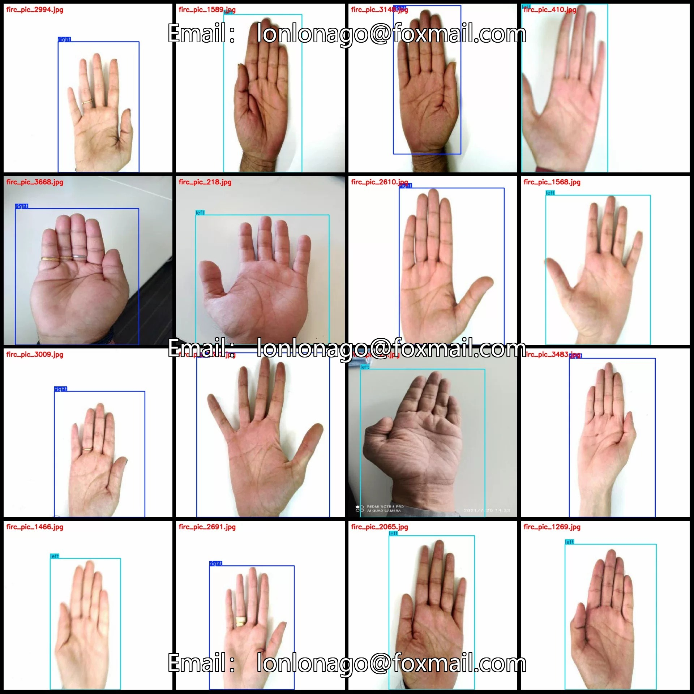
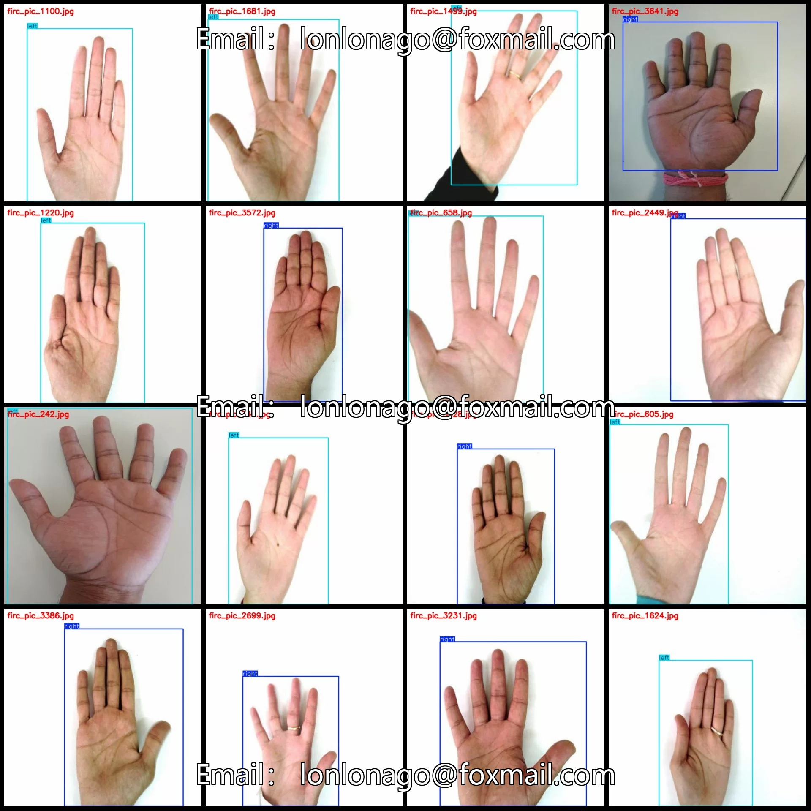
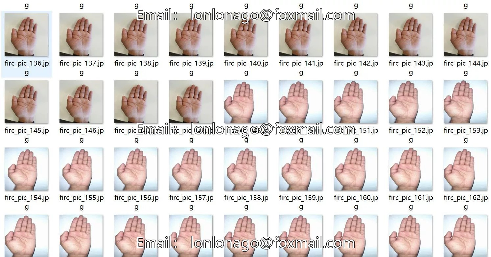
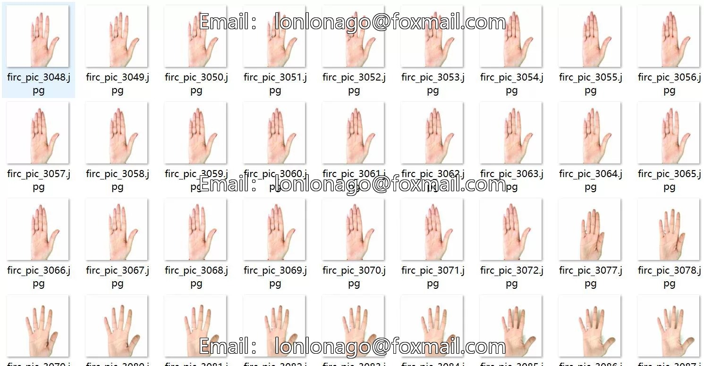
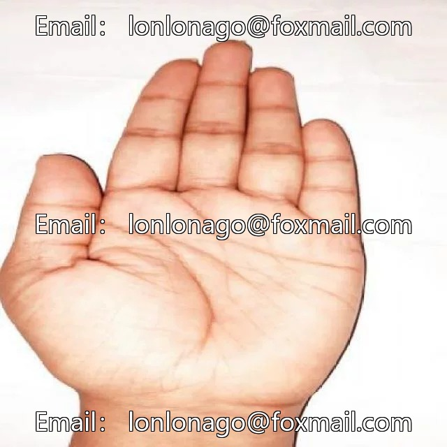
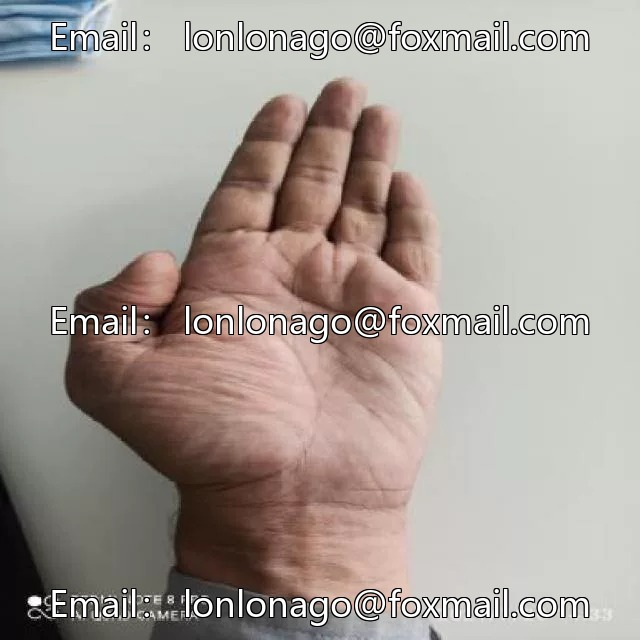
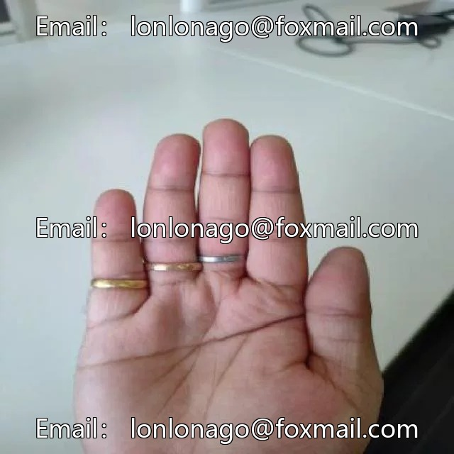

# Indoor biometric feature collection dataset for left and right palm detection in VOC+YOLO format with 373 samples

## Body

Indoor Biometric Feature Collection: Detection of the Right and Left Palms in VOC+YOLO Format with 3739 Images in 2 Categories
Warm Reminder: Due to the dataset's replicability, please confirm compliance before purchasing.
Note: The images in the dataset are formed by extracting frames from multiple videos, so there may be many "duplicate" images. Please refer to the images for specific details.
Dataset Format: Pascal VOC format + YOLO format (txt file without split path, only containing jpg images and corresponding VOC format xml files and yolo format txt files)
Number of Images (Total jpg Files): 3739
Number of Annotations (Total xml Files): 3739
Number of Annotations (Total txt Files): 3739
Number of Annotation Categories: 2

Label categories (note that the order of labels in YOLO format does not correspond to this, but is based on the classes.txt file in the labels folder): ["left", "right"]
Each category labeled boxes and image counts:
- Left boxes = 2340, image counts = 2336
- Right boxes = 1416, image counts = 1403
Total boxes: 3756
Image resolution: 640x640
Using labeling tool: labelImg
Labeling rules: Draw a rectangle around the category.
Important note: The dataset does not have splits for training, validation, or test sets; you need to manually divide them.
Special declaration: This dataset does not guarantee any accuracy for models trained or weight files.

## Images

## Payment

Here is a pay link on Stripe ( https://buy.stripe.com/3cs8yP7sY87d0vu9AB ). Please contact me lonlonago@foxmail.com after funding $89, and I will send you a complete data files , thank you!

